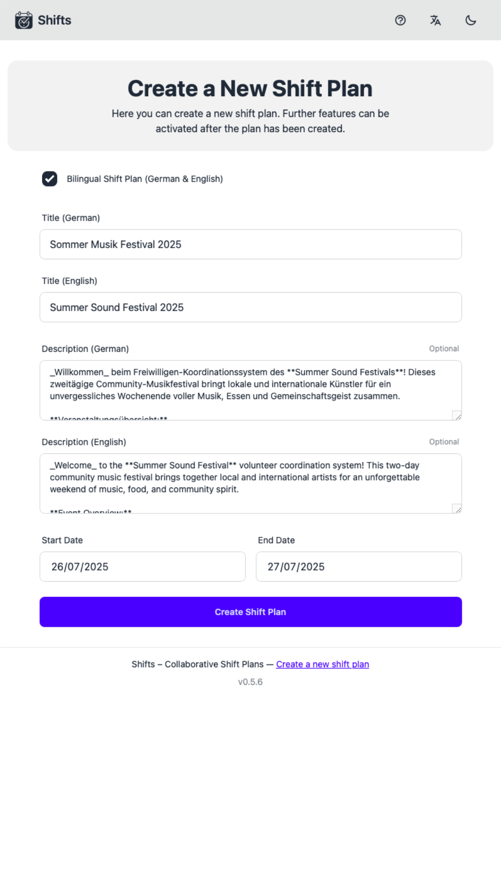
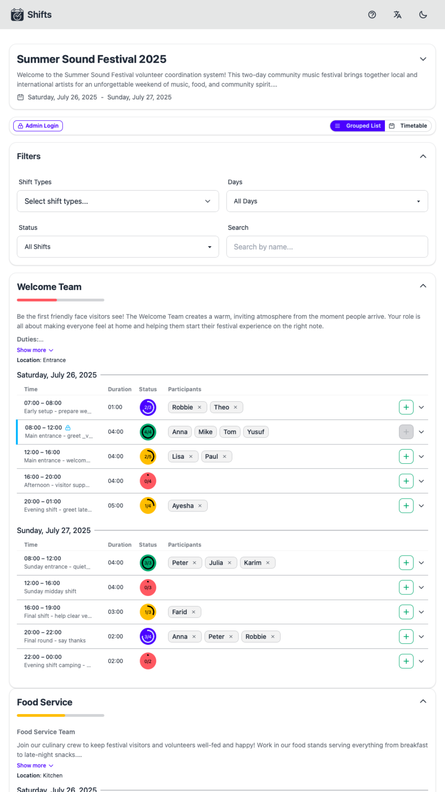
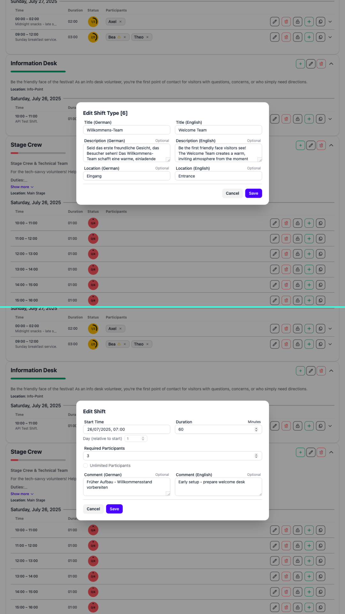

<p align="center">
  
</p>

# Shifts - Collaborative Shift Planning

The Shifts shift planning web application enables the collaborative coordination of shift cover for an event. Organisers simply need to share a URL with participants. Participants can then easily sign up using a nickname of their choice. Organisers always have a clear overview of how many shifts have already been filled. The application also offers exports in various formats as well as printable PDFs.

The application was developed out of frustration that existing tools were either too complicated for participants to use (login, email, etc.) or simply could not handle more complex events with numerous shifts and shift types.

> [!WARNING]
> **LLM Disclaimer.** This tool is the result of an experiment designed to investigate the potential applications of Vibe/Agentic Coding. The architecture was specified by humans. Nevertheless, it is likely that this code will contain the usual problems and errors associated with LLM coding agents. Use is therefore at your own risk, and you must carry out your own risk assessment. Apart from a freely chosen nickname, the tool does not store any user data.


## Showcase

A full list of features can be found [below](#features).

<table>
  <tr>
    <td align="center" width="50%">
      
      <br /><em>Create a new shift plan.</em>
    </td>
    <td align="center" width="50%">
      
      <br /><em>List view</em>
    </td>
  </tr>
  <tr>
    <td align="center" width="50%">
      
      <br /><em>Table view.</em>
    </td>
    <td align="center" width="50%">
      
      <br /><em>Edit shifts and shift types.</em>
    </td>
  </tr>
</table>


## Features

### Deployment

- **🚀 Single binary deployment:** Written in Go, with SQLite as the database backend. Deployment requires just a single binary — no external services or runtime dependencies.
- **📅 Unlimited shift plans per instance:** A single Shifts instance manages any number of independent shift schedules. No login is required to create them.

### Participant Experience

- **🔑 No login required for sign up:** Participants need only the link to the shift schedule and can sign up using a nickname of their choice. No account, login, or email address is needed.
- **🌐 Bilingual support:** Shift schedules can be created in a single language or in two languages simultaneously (currently German and English).
- **👀 List and table (timetable) views:** Two complementary views are available: a list view well suited to small screens, and a table/timetable view that provides a convenient overview of many shifts at once.
- **🌗 Light and dark mode:** Both light and dark modes are supported.
- **⚡ Live updates:** Changes by other people (sign-ups, shifts, types, settings, locks, deletion) appear in an open shift plan within about a second, without reloading. A status indicator shows the connection state and a viewer counter shows how many tabs of the plan are open. Changed shifts are briefly highlighted, open sign-up dialogs warn when a shift became full or was deleted, and the statistics page updates too. Can be switched off with `realtime_enabled` in `config.toml`.

### Shift Planning

- **📝 Flexible shift configuration with Markdown support:** Each shift schedule comprises a description (Markdown supported), shift types, and individual shifts. The number of required participants is configurable per shift; an unlimited headcount is also supported.
- **🤝 Collaborative and controlled planning mode:** Designed for scenarios where a significantly larger number of people are interested in shifts, or where organisers wish to retain control over the final allocation. Participants *apply* for shifts; organisers then confirm selections and lock the shift against further changes by non-admins.
- **🕒 Time zone per shift plan:** Each plan has its own time zone, chosen when the plan is created and fixed afterwards. Shift times are local times of the event and look the same on every device, regardless of the browser's time zone.
- **🧩 Easy application for multiple shifts:** The interface is designed to make signing up for several shifts as effortless as possible.

### Organiser Tools

- **🛡️ Admin-only mode:** The administration panel is secured with an admin password, which is displayed once immediately after the schedule has been created.
- **🔍 Multi-dimensional filter:** Shifts can be filtered along four independent dimensions — shift type, day, occupancy status, and participant name — applied in combination. The occupancy status filter distinguishes five levels: *empty* (no participants), *critical* (fewer than 50 % of required slots filled), *not full* (at least one vacancy remaining), *full* (exactly at capacity), and *overbooked* (more participants than required slots). The participant search performs a case-insensitive substring match across all enrolled names. Active filters carry through to both the list and timetable views as well as to CSV and PDF exports.
- **📊 Statistics:** Four tabs for coverage (key figures, per day and area, staffing heatmap), open spots, a sortable people table with overlap, rest and load warnings (CSV export for admins), and the sign-up history with a forecast. Area and day filters apply to all tabs and are kept in the URL. Unlimited shifts do not count into demand.
- **📚 Integrated documentation system:** A built-in documentation system powers the application's help pages.
- **📤 Export to CSV or PDF:** Shift schedules can be exported as CSV or PDF files. The PDF poster export, for instance, enables a transition to a paper-based schedule during the event itself.


### Export & Integration

- **🛠️ REST API with Swagger docs and batch operations:** A REST API is available with interactive Swagger/OpenAPI documentation and support for batch operations on shifts (creation, partial updates, and deletion). Documentation is accessible at `/swagger/index.html` once the server is running.
- **📈 Prometheus-compatible metrics endpoint:** An optional metrics endpoint exposes performance and business metrics in a Prometheus-compatible format on a configurable dedicated port (`metrics_port` in `config.toml`).


## Installation

Pre-built binaries are available on the [GitHub Releases](https://github.com/72nd/shifts/releases) page. Because the SQLite driver relies on CGo, cross-compilation is not straightforward, and only Linux builds for **amd64** and **arm64** are provided. For all other platforms — including macOS and Windows — the binary must be compiled locally as described in the [Build](#build) section below.

To install a pre-built release, download the appropriate binary and make it executable.

```bash
chmod +x shifts
```

Then create a configuration file in your working directory (see [Configuration](#configuration)):

```bash
cp config.template.toml config.toml
```

Run the application:

```bash
./shifts
```


## Build

### Requirements

- [Go 1.24](https://go.dev/dl/) or higher
- SQLite3 development headers (required because the Go SQLite driver uses CGo)
- The Swag CLI tool is also required to generate the API documentation. When building via the Makefile it is installed automatically; for a manual build see Option B below.

### Option A — Using the Makefile (recommended)

1. Install the SQLite development headers:
   - **Debian / Ubuntu:** `sudo apt install libsqlite3-dev`
   - **Fedora / RHEL:** `sudo dnf install sqlite-devel`
   - **Arch Linux:** `sudo pacman -S sqlite`
   - **macOS (Homebrew):** `brew install sqlite`
   - **Windows:** headers are bundled with the driver; no separate installation is needed.

2. Clone the repository:
   ```bash
   git clone https://github.com/72nd/shifts.git
   cd shifts
   ```

3. Create and adjust the configuration file (see [Configuration](#configuration) for all available options):
   ```bash
   cp config.template.toml config.toml
   ```

4. Build the application — Swag is installed automatically if missing:
   ```bash
   make install
   ```

5. Run the application:
   ```bash
   ./shifts
   ```

Run `make help` to see all available targets.

### Option B — Manual

1. Install the SQLite development headers (see platform list in Option A above).

2. Install the Swag CLI tool:
   ```bash
   go install github.com/swaggo/swag/cmd/swag@latest
   ```

3. Clone the repository:
   ```bash
   git clone https://github.com/72nd/shifts.git
   cd shifts
   ```

4. Install Go dependencies:
   ```bash
   go mod download
   ```

5. Generate the Swagger API documentation:
   ```bash
   swag init -g cmd/shifts/main.go -o docs --parseDependency --parseInternal
   ```

6. Create and adjust the configuration file (see [Configuration](#configuration) for all available options):
   ```bash
   cp config.template.toml config.toml
   ```

7. Build the binary:
   ```bash
   CGO_ENABLED=1 go build -o shifts cmd/shifts/main.go
   ```

8. Run the application:
   ```bash
   ./shifts
   ```


## Updating

To update an existing installation to the latest release, run:

```bash
make all
```

This fetches the latest release tag, regenerates the Swagger docs, and recompiles the binary in one step. To update to the latest development branch instead:

```bash
make update MODE=dev && make install
```

The database schema is upgraded automatically on startup. Before the first migration on an existing database, Shifts writes a backup next to it (`<db_path>.<timestamp>.pre-migration.bak`). A database that was migrated by a newer version is not opened by an older binary; restore the backup to go back.


## Configuration

The application uses a TOML configuration file for its settings. By default, it looks for a `config.toml` file in the current working directory. You can specify a different configuration file location using the `--config` flag.

### Configuration File

Copy the template configuration file to create your own:
```bash
cp config.template.toml config.toml
```

Available configuration options:

- `host`: Server host address (default: "localhost")
- `port`: Server port (default: 8080)
- `db_path`: Path to the SQLite database file (default: "data/shifts.db")
- `log_level`: Logging level (default: "info")
- `metrics_enabled`: Enable Prometheus metrics endpoint (default: false)
- `metrics_port`: Port for the Prometheus metrics endpoint (default: 9090)
- `default_view`: Default view for shift plans when the visitor has no `?view=` or saved preference (`"timetable"` or `"list"`) (default: "timetable")
- `timezone`: IANA time zone preselected when creating a shift plan. Existing plans are converted with this zone during the database migration to v0.6.0. Each plan stores its own zone afterwards, so this option does not change existing plans (default: "Europe/Berlin")
- `realtime_enabled`: Enable live updates via Server-Sent Events at `GET /api/plans/{token}/events`. When `false`, the endpoint returns 404 and pages only show changes after a reload (default: true)


Example configuration:
```toml
# Server configuration
host = "localhost"
port = 8080

# Database configuration
db_path = "data/shifts.db"

# Logging configuration
log_level = "info"

# Metrics configuration
metrics_enabled = true
metrics_port = 9090

# Default view for shift plans when the visitor has no ?view= or saved preference ("timetable" or "list")
default_view = "timetable"

# Default IANA time zone for new plans and for converting existing plans during migration
timezone = "Europe/Berlin"

# Live updates via Server-Sent Events (GET /api/plans/{token}/events). false = endpoint returns 404.
realtime_enabled = true
```

### Live Updates: Notes for Operators

Live updates are sent over Server-Sent Events. Please check the following when you run Shifts behind a reverse proxy or in a multi-instance setup:

- **Do not buffer the event stream.** The proxy must pass `text/event-stream` responses through without buffering, otherwise updates arrive late or not at all. Shifts already sends the `X-Accel-Buffering: no` header, which nginx honours. For nginx, also set `proxy_buffering off;` for the Shifts location, and set `proxy_read_timeout` to more than 30 seconds (the server sends a keep-alive ping every 25 seconds). Other proxies need the equivalent settings.
- **Connection limit in browsers.** Over HTTP/1.1, browsers allow only six connections per domain. Each open shift plan tab holds one event stream, so many plan tabs on the same host can exhaust the limit. HTTP/2 avoids this.
- **Single process.** Updates are distributed in memory. Run exactly one Shifts process per database. Several instances behind a load balancer do not see each other's changes.
- **Switching off.** Set `realtime_enabled = false` in `config.toml` to disable the endpoint. The rest of the application keeps working; changes then appear only after a page reload.

## API Documentation

The Swagger documentation is generated automatically during every build (via `make install` or `make docs`). To regenerate it manually, run from the project root:

```bash
swag init -g cmd/shifts/main.go -o docs --parseDependency --parseInternal
```

This produces `docs/swagger.json`, `docs/swagger.yaml`, and `docs/docs.go`. Once the server is running, the documentation is available at:

- Swagger UI: `http://localhost:8080/swagger/index.html`
- OpenAPI JSON: `http://localhost:8080/swagger/doc.json`


## Metrics

When `metrics_enabled = true` is set in `config.toml`, the application exposes a Prometheus-compatible `/metrics` endpoint on a dedicated port (default: 9090). Five groups of metrics are collected:

- **HTTP**: request count, latency histograms, and current in-flight requests — labelled by method, path, and status code.
- **Database**: query count and duration per operation and table; errors categorised by type (lock contention, constraint violations, schema errors).
- **Business**: counters for shift plans, shifts, and participant operations (joins, removals, and failures with failure reason).
- **Exports & Authentication**: generation count, duration, and errors per export format; admin login attempt count and duration.
- **Live updates**: open event streams (`shifts_realtime_connections`) and events sent (`shifts_realtime_events_total`).

The endpoint is designed to be scraped by a Prometheus instance and is fully compatible with standard dashboarding tools such as Grafana.
